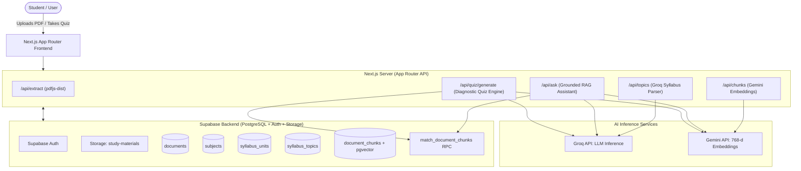

# GapFinder AI — Academic Learning Gap Identification & Study Assistant

> An AI-powered academic learning assistant that analyzes college syllabi, course schemes, and study materials to diagnose learning gaps and deliver targeted revision recommendations.

- **Live Deployment:** [https://gapfinder-ai-snowy.vercel.app/](https://gapfinder-ai-snowy.vercel.app/)
- **Repository:** [https://github.com/santosh1234321/gapfinder-ai](https://github.com/santosh1234321/gapfinder-ai)

---

## 1. Project Title and Description

**GapFinder AI** is an intelligent academic companion built for undergraduate and college students. Unlike generic AI chatbots that hallucinate external facts or invent unverified curriculum rules, GapFinder AI ingests university syllabi and curriculum schemes, extracts their structural hierarchy (units, modules, topics, credits), indexes content via vector embeddings, and generates diagnostic assessments. After each quiz, the system pinpoints exactly which academic topics the student struggled with and delivers an actionable, personalized revision plan.

---

## 2. Problem Statement

College students frequently struggle with the **illusion of competence**: passively rereading notes and lecture slides gives a false sense of mastery, only for students to discover critical blind spots during examinations. Furthermore, existing AI tools:
- Produce generic answers unsupported by the student's specific university syllabus regulations or course codes.
- Hallucinate academic facts, credits, and prerequisites.
- Offer conversational chatter without identifying what the student knows vs. what they do not know.

---

## 3. Proposed Solution

GapFinder AI solves this by introducing a closed-loop academic diagnostic workflow:
1. **Document Ingestion:** Students upload official syllabi or curriculum schemes in PDF format.
2. **Structural Decomposition:** The system extracts text and parses hierarchical topics (units, topics, subtopics).
3. **Strict Grounding:** Text chunks are vectorized using Gemini embeddings (`gemini-embedding-001`, 768 dimensions) and stored in Supabase pgvector. An AI Study Assistant answers questions strictly citing exact document excerpts.
4. **Diagnostic Assessment:** The application dynamically generates 5-question multiple-choice quizzes linked directly to the document's verified content.
5. **Academic Gap Analysis & Revision Plan:** The student's responses are scored, isolating demonstrated knowledge from weak areas, and converting gaps into an immediate revision checklist.

---

## 4. Key Features

- **Document Processing Pipeline:** Client-side validation, secure PDF text extraction via `pdfjs-dist`, and private file storage in Supabase Storage.
- **Syllabus & Curriculum Analysis:** Automated identification of subjects, units, course codes, and topics powered by Groq LLMs.
- **Vector Search & Semantic Retrieval:** Sentence-aware overlapping chunking and cosine-similarity retrieval through PostgreSQL pgvector (`match_document_chunks`).
- **Grounded AI Study Assistant:** Strict source grounding prevents hallucination. Every claim cites source excerpts with collapsible source verification panels.
- **Dynamic 5-Question Diagnostic Quizzes:** Automatically generated multiple-choice assessments with 4 options (A, B, C, D) and grounded explanations.
- **Academic Gap Analysis Breakdown:** Transparent categorization of student performance into "Demonstrated Understanding" vs. "Knowledge Gaps Identified".
- **Personalized Revision Recommendations:** Actionable study directives targeting missed topics and advising specific review steps.
- **Secure Authentication:** Supabase Auth with session management, protected routes, and Row Level Security (RLS).

---

## 5. Technology Stack

- **Frontend & Fullstack Framework:** Next.js 16 (App Router, Turbopack, Server Actions / Route Handlers)
- **Language:** TypeScript 5
- **Styling:** Tailwind CSS v4
- **Database & Storage:** Supabase PostgreSQL with `pgvector` extension and Supabase Storage
- **Authentication:** Supabase Auth (`@supabase/ssr`, `@supabase/supabase-js`)
- **LLM Reasoning & Generation:** Groq SDK (`openai/gpt-oss-120b` with automatic fallback to `llama-3.3-70b-versatile`)
- **Vector Embeddings:** Google Gemini API (`gemini-embedding-001`, 768-dimensional embeddings)
- **Document Text Extraction:** `pdfjs-dist` (legacy build with headless worker support)
- **Hosting & CI/CD:** Vercel & GitHub

---

## 6. System Architecture



---

## 7. Application Workflow

1. **Sign Up / Login:** The user registers or signs in via Supabase Authentication.
2. **Dashboard Overview:** Displays uploaded materials, current processing states, and quick-action launcher cards.
3. **Upload Material (`/upload`):**
   - Step 1: Select and validate local PDF (< 10 MB).
   - Step 2: Extract text via PDF.js worker.
   - Step 3: Store PDF in Supabase Storage (`study-materials`) and insert metadata record in `documents`.
   - Step 4: Analyze syllabus with Groq to identify subjects, units, and main topics.
   - Step 5: Split text into sentence-aware overlapping chunks, compute Gemini embeddings, and store in `document_chunks`.
4. **Interactive AI Study Assistant (`/chat`):**
   - Student selects an indexed document and submits questions.
   - Query is embedded and matched against document chunks via `match_document_chunks`.
   - AI outputs a strictly grounded answer with inline citations and expandable source cards.
5. **Diagnostic Quiz & Gap Analysis (`/quiz`):**
   - Student selects an active document and clicks **Generate 5-Q Quiz**.
   - Questions test factual curriculum details (credits, course codes, electives, prerequisites, or topics).
   - Student submits answers $\to$ system calculates score, isolates Strong vs. Weak areas, and displays a customized revision action plan.

---

## 8. Project Folder Structure

```
gapfinder-ai/
├── app/
│   ├── api/
│   │   ├── ask/route.ts              # Grounded RAG Q&A endpoint
│   │   ├── chunks/route.ts           # Sentence-aware chunking & Gemini embeddings
│   │   ├── extract/route.ts          # PDF text extraction route (pdfjs-dist)
│   │   ├── quiz/generate/route.ts    # Resilient diagnostic quiz generator
│   │   ├── search/route.ts           # Semantic vector search endpoint
│   │   └── topics/route.ts           # Groq syllabus analysis & hierarchy extractor
│   ├── auth/callback/route.ts        # Supabase OAuth/email verification callback
│   ├── chat/page.tsx                 # Interactive AI Study Assistant UI
│   ├── components/
│   │   └── navbar.tsx                # Universal responsive navigation header
│   ├── dashboard/page.tsx            # Student dashboard & materials overview
│   ├── login/page.tsx                # User login page
│   ├── quiz/page.tsx                 # Diagnostic quiz, scoring & gap analysis UI
│   ├── register/page.tsx             # New user registration page
│   ├── upload/page.tsx               # Stepped PDF upload & indexing pipeline
│   ├── globals.css                   # Global styles & Tailwind CSS v4 theme
│   ├── layout.tsx                    # Root layout with system font stack
│   └── page.tsx                      # Modern AI SaaS Landing Page
├── lib/
│   ├── gemini/client.ts              # Gemini API client & 768-d embedContent
│   ├── groq/client.ts                # Groq SDK client
│   └── supabase/
│       ├── client.ts                 # Supabase browser client (SSR helper)
│       └── server.ts                 # Supabase server client with cookies
├── public/                           # Static assets & SVG icons
├── .gitignore                        # Git exclusion rules
├── AGENTS.md                         # Project developer & agent instructions
├── next.config.ts                    # Next.js configuration
├── package.json                      # Dependencies & build scripts
├── proxy.ts                          # Edge proxy & session refresh configuration
└── tsconfig.json                     # TypeScript compiler configuration
```

---

## 9. Installation Instructions

### Prerequisites
- Node.js 20 or higher
- npm, pnpm, or yarn
- Supabase account with an active project
- Groq API key
- Google Gemini API key

### Clone Repository
```bash
git clone https://github.com/santosh1234321/gapfinder-ai.git
cd gapfinder-ai
```

### Install Dependencies
```bash
npm install
```

---

## 10. Environment Variable Names

Create a `.env.local` file in the root directory:

```env
# Supabase Configuration
NEXT_PUBLIC_SUPABASE_URL=https://your-supabase-project.supabase.co
NEXT_PUBLIC_SUPABASE_ANON_KEY=your_supabase_anon_key

# AI Provider Keys
GROQ_API_KEY=gsk_your_groq_api_key
GEMINI_API_KEY=your_gemini_api_key
```

> **Note:** Never commit `.env.local` or expose private API keys in client-side code.

---

## 11. Supabase Configuration Requirements

1. **Storage Bucket:**
   - Create a private bucket named `study-materials`.
   - Ensure authenticated users have insert/select permissions for their own files.

2. **Tables:**
   - `profiles` (`id`, `username`, `full_name`, `created_at`)
   - `documents` (`id`, `user_id`, `file_name`, `storage_path`, `file_type`, `file_size`, `processing_status`, `created_at`)
   - `subjects` (`id`, `document_id`, `user_id`, `name`, `created_at`)
   - `syllabus_units` (`id`, `subject_id`, `user_id`, `unit_name`, `unit_title`, `position`)
   - `syllabus_topics` (`id`, `unit_id`, `user_id`, `topic_name`, `position`, `parent_topic_id`)
   - `document_chunks` (`id`, `document_id`, `user_id`, `chunk_index`, `content`, `embedding vector(768)`, `created_at`)

3. **PostgreSQL pgvector Matching Function:**
```sql
CREATE EXTENSION IF NOT EXISTS vector;

CREATE OR REPLACE FUNCTION match_document_chunks (
  query_embedding vector(768),
  match_count int,
  filter_document_id uuid DEFAULT NULL
)
RETURNS TABLE (
  id uuid,
  document_id uuid,
  content text,
  similarity float
)
LANGUAGE plpgsql
AS $$
BEGIN
  RETURN QUERY
  SELECT
    dc.id,
    dc.document_id,
    dc.content,
    1 - (dc.embedding <=> query_embedding) AS similarity
  FROM document_chunks dc
  WHERE
    dc.user_id = auth.uid()
    AND (filter_document_id IS NULL OR dc.document_id = filter_document_id)
  ORDER BY dc.embedding <=> query_embedding
  LIMIT match_count;
END;
$$;
```

---

## 12. Local Development Instructions

Start the Next.js local development server:

```bash
npm run dev
```

Open [http://localhost:3000](http://localhost:3000) in your browser.

To verify a production build locally:
```bash
npm run build
npm run start
```

---

## 13. Vercel Deployment Instructions

1. Push your repository to GitHub: `git push origin main`.
2. Connect the repository to [Vercel](https://vercel.com).
3. In **Project Settings $\to$ Environment Variables**, configure:
   - `NEXT_PUBLIC_SUPABASE_URL`
   - `NEXT_PUBLIC_SUPABASE_ANON_KEY`
   - `GROQ_API_KEY`
   - `GEMINI_API_KEY`
4. In your **Supabase Authentication Settings**, add your Vercel deployment URL to the **Redirect URLs** list:
   - `https://gapfinder-ai-snowy.vercel.app/auth/callback`
5. Trigger a deployment. Subsequent commits to `main` will automatically build and deploy.

---

## 14. Screenshots Section

| Screen | Description |
| :--- | :--- |
| **Landing Page** (`/`) | Modern AI SaaS landing page explaining gap identification and workflow. |
| **Dashboard** (`/dashboard`) | Uploaded study materials overview, processing statuses, and quick actions. |
| **Material Upload** (`/upload`) | 5-step processing pipeline: Select $\to$ Extract $\to$ Save $\to$ Analyze $\to$ Embed. |
| **AI Study Assistant** (`/chat`) | Grounded RAG chat with document picker and collapsible source citations. |
| **Diagnostic Assessment** (`/quiz`) | 5-question multiple choice quiz with instant option selection. |
| **Gap Analysis & Revision** (`/quiz`) | Score breakdown, Demonstrated vs. Weak Areas, and targeted action plan. |

---

## 15. Future Improvements

- **Interactive Flashcard Generator:** Auto-convert identified weak topics into spaced repetition flashcards.
- **Multi-Document Comparative Search:** Cross-reference lecture slides against university curriculum syllabi to detect unaddressed course outcomes.
- **Exportable Revision Calendars:** Export personalized revision action plans directly to Google Calendar or iCal.
- **Progress Analytics Over Time:** Longitudinal tracking showing gap closure across consecutive diagnostic quizzes.
